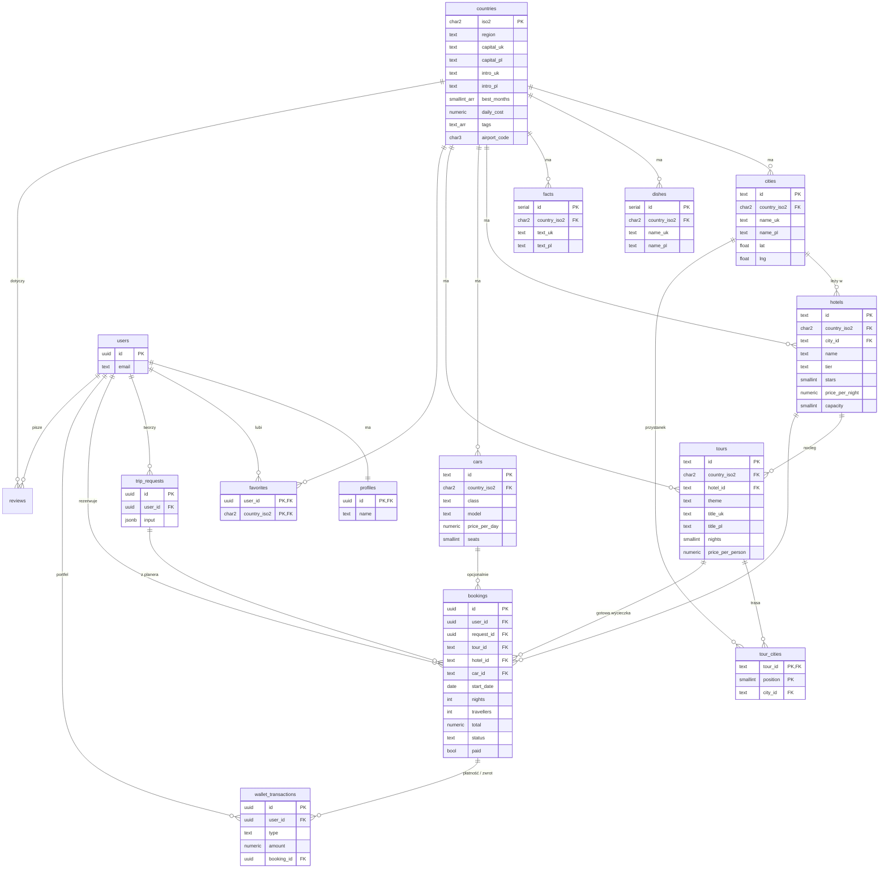

# Baza danych ETravel

**PostgreSQL w chmurze Supabase.** Schemat: [`supabase/schema.sql`](../supabase/schema.sql), dane: [`supabase/seed.sql`](../supabase/seed.sql).

Baza składa się z dwóch części:

- **Katalog (publiczny, tylko do odczytu).** 8 tabel: kraje Europy i wszystko, co do nich należy.
- **Dane użytkowników (prywatne).** 5 tabel: profile, ulubione, zapytania, rezerwacje i portfel (operacje demo).
- **Opinie (publiczne).** Tabela `reviews`: każdy może czytać, zalogowany użytkownik dodaje własne. Chroni je Row Level Security: każdy widzi tylko swoje wiersze.

## Diagram ERD



## Tabele

| Tabela | Co przechowuje | Wierszy |
|---|---|---|
| `countries` | 41 krajów Europy: region, stolica, opis (UA/PL/EN), najlepsze miesiące, dzienny koszt, tagi, lotnisko | 41 |
| `cities` | Miasta warte odwiedzenia ze współrzędnymi i opisem | 154 |
| `dishes` | Narodowe dania | 125 |
| `facts` | Ciekawostki o kraju | 124 |
| `hotels` | Po 5 hoteli na kraj, każdy innej klasy (budżetowy, 3★, 4★, butikowy, 5★), z ceną za noc | 205 |
| `cars` | Po 3 samochody na kraj (ekonomiczny, SUV, premium) z ceną za dzień | 123 |
| `tours` | Po 3 gotowe wycieczki na kraj (morze, góry, romantycznie, rodzinnie…) | 123 |
| `tour_cities` | Trasa wycieczki: kolejne miasta (relacja wiele-do-wielu) | 296 |
| `auth.users` | Konta: e-mail i hasło (zahaszowane przez Supabase Auth) | — |
| `profiles` | Imię użytkownika; wiersz tworzy automatycznie trigger `handle_new_user` | — |
| `favorites` | Ulubione kraje użytkownika | — |
| `trip_requests` | Zapytania z planera podróży (budżet, daty, preferencje) w kolumnie `jsonb` | — |
| `bookings` | Rezerwacje: hotel, opcjonalnie samochód, daty, liczba osób, kwota, status, czy opłacona | — |
| `reviews` | Opinie z oceną 1–5 o kraju, mieście, hotelu, samochodzie, wycieczce lub o serwisie ETravel | 294 |
| `wallet_transactions` | Portfel demo: doładowania (+), płatności (−) i zwroty (+); saldo = suma operacji | — |

## Integralność i bezpieczeństwo

- **Klucze obce** z `on delete cascade`. Usunięcie kraju usuwa jego miasta, hotele i wycieczki.
- **Ograniczenia `check`.** Na przykład `nights between 1 and 30`, `price_per_night > 0`, `status in ('confirmed','cancelled')`, kod kraju `^[A-Z]{2}$`.
- **Row Level Security.**
  - Katalog: polityka `public read` (każdy może czytać, nikt nie zapisuje przez API).
  - Dane użytkownika: `user_id = auth.uid()`, czyli wyłącznie właściciel.
- **Funkcje portfela** (`security definer`): `wallet_top_up`, `pay_booking`, `cancel_booking`, `wallet_balance`. Tylko one zmieniają saldo. `pay_booking` blokuje wiersz (`for update`) i sprawdza saldo, więc nie da się zapłacić dwa razy ani zejść poniżej zera. Anulowanie opłaconej rezerwacji zwraca pieniądze.
- **Trigger.** Po rejestracji w `auth.users` od razu powstaje wiersz w `profiles`.
- **Indeksy** po `country_iso2` i `(user_id, created_at)` przyspieszają typowe zapytania.
- **Widok `country_overview`.** Najtańszy nocleg i liczba wycieczek dla każdego kraju.

## Przykładowe zapytania

```sql
-- Najtańsze kraje na wakacje nad morzem
select c.iso2, c.capital_pl, min(h.price_per_night) as od_eur
from countries c join hotels h on h.country_iso2 = c.iso2
where 'sea' = any(c.tags)
group by c.iso2, c.capital_pl order by od_eur limit 5;

-- Trasa gotowej wycieczki
select t.title_pl, tc.position, ci.name_pl
from tours t join tour_cities tc on tc.tour_id = t.id join cities ci on ci.id = tc.city_id
where t.id = 'hr-sea' order by tc.position;
```

## Uruchomienie

1. **Lokalnie, bez konta.** `npm install && npm run db:check` wczytuje schemat i dane do PostgreSQL w pamięci (PGlite) i wypisuje statystyki.
2. **Supabase.** W *SQL Editor* uruchom kolejno `supabase/schema.sql` i `supabase/seed.sql`.
3. **Aktualizacja danych.** Treści krajów leżą w `src/data/countries/*.json`. Komenda `npm run db:seed` generuje z nich nowy `seed.sql`, więc strona i baza mają jedno źródło prawdy.
